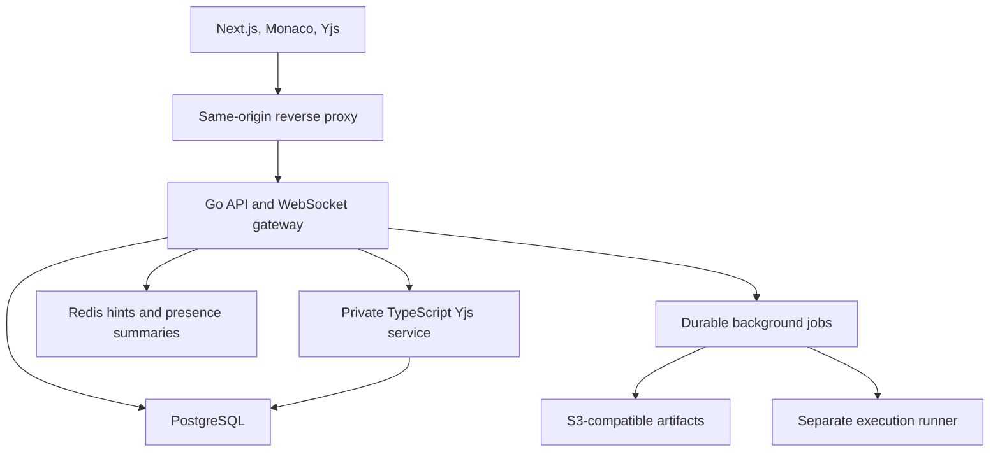

# Collaborative Code Editor — Architecture and Codex Build Prompts

## 1. Correct project and outcome

Build a **Collaborative Code Editor**: a browser workspace in which authenticated teammates edit the same files concurrently, see each other's cursors, manage a shared file tree, reconnect without discarding their work, create restorable checkpoints, and run an immutable version of their code in a restricted execution environment.

The experience is inspired by Google Docs collaboration and VS Code's editor. The core project is the collaboration platform. Its history/checkpoints are application features, not an implementation of Git.

Use **Next.js + TypeScript + Monaco + Yjs**, a **Go API/WebSocket gateway**, and a small **TypeScript collaboration service** that understands Yjs. PostgreSQL holds authoritative metadata and durable CRDT updates. Redis holds disposable coordination/presence hints. MinIO provides local S3-compatible checkpoint storage. A separate runner handles code execution.

The project demonstrates concurrency, synchronization, durability, authorization, asynchronous work, execution isolation, observability, and real multi-user product behavior. Describe Yjs as the CRDT library you integrated; do not claim to have invented its algorithm.

## 2. Product scope

### Required portfolio release

- GitHub.com OAuth login and protected projects.
- Project owner, editor, and viewer roles; invite acceptance and revocation.
- Shared folders/files, rename, move, deletion, and consistent file-tree events.
- Monaco editing, language highlighting, tabs, and per-user undo/redo.
- Yjs concurrent editing with stable document identities.
- Authenticated shared cursors/presence.
- Durable edit receipts and accurate saving/offline/error states.
- Browser-local drafts/outbox, reconnect synchronization, and server-restart recovery.
- Automatic document snapshots plus named project checkpoints, preview, and restore.
- Python and JavaScript execution from a captured immutable project checkpoint.
- Bounded output, job status, stdin, cancellation, and execution quotas.
- Project-scoped filename/content search with version-aware results.
- Logs, metrics, traces, integration tests, load/failure demonstrations, and deployment docs.

### Later extensions

Language-server protocol integration, comments, team chat, GitHub repository import/export, read-only checkpoint links, richer runtime support, horizontally sharded collaboration workers, OpenSearch indexing, Kafka consumers, and Kubernetes deployment.

The first release does not promise the VS Code extension ecosystem, an unrestricted shared terminal, public anonymous execution, unlimited files, or capacity that has not been measured. A console that displays run output must be labeled **Output**, not presented as an interactive shell.

## 3. Stack decisions

| Original layer | Final choice | Stage and responsibility |
|---|---|---|
| Frontend | Next.js + TypeScript | Core: application UI and client routing |
| Editor | Monaco Editor | Core: editing model, highlighting, selections |
| Real-time transport | WebSockets through Go | Core: authenticated connection gateway, limits, routing |
| Collaboration | Yjs, y-monaco, documented provider adapter | Core: shared text, relative positions, selective undo |
| Backend | Go | Core: auth, projects, file metadata, jobs, checkpoints, public APIs |
| Yjs authority | Small Node.js/TypeScript service | Core: decode/apply Yjs updates, restore documents, validate candidates |
| API | REST + document/control WebSockets | Core: explicit contracts |
| Database | PostgreSQL | Core: metadata, sessions, permissions, durable update log, jobs/outbox |
| Cache | Redis | Core support: TTL presence summaries and notification hints; database fallback |
| Message broker | Kafka | Later: multiple durable event consumers through a transactional outbox |
| Object storage | MinIO locally; S3-compatible provider in deployment | Checkpoint/export artifacts with authorized access |
| Authentication | OAuth + HttpOnly application session; short-lived internal JWT assertions | Browser sessions are revocable; JWT scopes the gateway-to-worker handshake |
| Code execution | Separate Docker runner | Restricted private-demo execution; stronger sandbox before public untrusted use |
| Search | PostgreSQL projections first; OpenSearch later | Eventual content indexing, with authorization on every query |
| Metrics | Prometheus + Grafana | Connection/latency/error/run metrics and dashboards |
| Tracing | OpenTelemetry | Correlation across gateway, collaboration, database, and jobs |
| Deployment | Docker Compose first; Kubernetes later | Reproducible development before multi-node deployment |

The Go service is not required to reimplement the Yjs binary format. Keeping Yjs application/validation in TypeScript avoids assuming that a generic Go WebSocket server can safely interpret CRDT content, materialize checkpoints, or enforce read-only behavior by itself.

This is a small set of deliberate process boundaries, not one service per feature. Begin with one API/gateway process, one collaboration worker, PostgreSQL, Redis, and the web app. Add object storage and the runner when their phases begin.

## 4. System topology



Only the frontend and Go public endpoints are reachable by browsers. The collaboration service, database, Redis, object-storage administration, and runner control interface remain private.

Route the frontend, `/api/v1/*`, `/ws/documents/*`, and `/ws/projects/*` through one origin. This simplifies cookie-authenticated WebSocket access. Production uses HTTPS/WSS. Local development uses explicit localhost configuration. Never weaken origin or auth checks globally just to make a demo connect.

## 5. Service and source boundaries

| Source path | Responsibility |
|---|---|
| `apps/web/` | Next.js application, workspace UI, Monaco lifecycle |
| `apps/web/src/collaboration/` | Provider adapter, IndexedDB outbox, receipts, reconnect, awareness |
| `services/api/` | Go REST API, OAuth/session middleware, WebSocket gateway, project events |
| `services/collab/` | TypeScript room ownership, Yjs decoding/validation, persistence, hydration |
| `services/jobs/` | Background checkpoint materialization and search projection worker; may share the Go codebase |
| `services/runner/` | Separate execution agent with restricted runtime templates |
| `packages/protocol/` | TypeScript protocol codecs, schemas, fixtures |
| `contracts/` | OpenAPI, WebSocket framing, authorization, lifecycle and receipt contracts |
| `db/migrations/` | One canonical SQL migration source for both Go and TypeScript services |
| `infra/compose/` | Reproducible development stack and explicit profiles |
| `infra/observability/` | Collector, Prometheus scrape config, dashboard definitions |
| `tests/e2e/` | Playwright multi-user/multi-context tests |
| `tests/integration/` | Real database/WebSocket/worker/runner tests |
| `tests/load/` | Reproducible collaboration workloads and correctness checks |
| `docs/` | Architecture, invariants, limitations, measured results, demonstration |

The frontend never writes database rows. Go owns normal metadata changes. TypeScript can read the necessary metadata and execute tightly scoped document-persistence functions. The runner receives immutable job inputs and cannot call general project APIs or read application credentials.

Use maintained libraries for OAuth, WebSockets, database access, Yjs, and Monaco. Pin compatible versions when implementation begins and retain lockfiles. Ensure one compatible Yjs package instance across frontend dependencies. Do not silently use a hosted collaboration provider to replace this project's own backend.

## 6. Three different kinds of state

| State | Authority | Lifetime |
|---|---|---|
| File contents | Durable Yjs updates/snapshots in PostgreSQL | Persistent |
| Projects, tree, permissions, current document generation | PostgreSQL | Persistent |
| Cursor/selection, online status | Room awareness + optional Redis TTL summary | Ephemeral |

Redis is not the durable document store. A cursor is not a saved code edit. Search text is a projection, not the source of truth.

Represent each text file generation with one `Y.Doc` containing one shared `Y.Text` named `content`. This enables file-level authorization, bounded hydration, and room-level resource control. File/folder metadata remains transactional SQL data, not a second CRDT file tree.

### Stable identity and generations

- A file has an immutable `file_id` independent of its path.
- Its current content has an immutable `document_id` and numeric generation.
- A rename changes metadata, not file/document identity or the room.
- Restore creates a **new document generation** rather than replacing text inside the old CRDT history.
- Delete tombstones the file and invalidates writes to its document.
- Offline updates addressing an old/deleted generation are rejected and retained as a recoverable draft.

This prevents an old offline tab from merging pre-restore edits into a newly restored version without explicit user action.

## 7. Data model

| Table | Main fields and invariants |
|---|---|
| `users` | UUID, provider, provider subject, display name; unique provider identity |
| `sessions` | UUID, hashed random session token, user, expiration, revoked status |
| `projects` | UUID, owner, name, tree version, metadata event sequence, lifecycle state |
| `project_members` | Project/user unique pair, owner/editor/viewer role; owner matches project owner |
| `project_invites` | Hashed high-entropy token, project, permitted role, expiry, bounded uses |
| `files` | UUID, project, parent folder, name, kind, language, current document UUID, tombstone |
| `documents` | UUID, file, generation, contiguous last committed sequence, snapshot pointer |
| `document_updates` | Document, sequence, authenticated actor, client instance, message ID, update bytes/hash |
| `document_snapshots` | Document, through-sequence, encoded Yjs state, state vector, checksum, creation time |
| `document_owners` | Document, worker, fencing token, lease expiration |
| `project_events` | Project, monotonic event sequence, validated metadata event |
| `checkpoints` | Project, captured tree, per-document cut, creator, status, immutable manifest reference |
| `checkpoint_files` | Captured file IDs/paths/languages/document IDs/sequences and artifact checksums |
| `run_jobs` | Project, actor, immutable checkpoint, runtime/entrypoint/stdin, state, attempts, lease |
| `run_events` | Job, sequence, bounded stdout/stderr/status events |
| `outbox_events` | Durable asynchronous event, operation ID, consumer state |
| `search_documents` | Project/file/document/sequence, filename and text projection |

`document_updates` has unique `(document_id, sequence)` and unique `(document_id, client_instance_id, message_id)` keys. A repeated ID with different actor or payload hash is a conflict, not a successful duplicate.

Allocate sequence numbers by locking the document row and incrementing its counter inside the same append transaction. Do not use an independent global sequence as the document's contiguous replay watermark. Encode API sequence values as decimal strings and use 64-bit/BigInt types internally to avoid JavaScript integer precision errors.

Active sibling names are unique, including at the root. Define NULL-parent uniqueness explicitly in the SQL migration rather than relying on a nullable composite index to reject all duplicates. Prevent parent cycles, cross-project parenting, duplicate owner roles, invalid active document references, and tree-depth/path-size overflow.

Do not store a second authoritative `files.content` string. Plain text for search/export/run is generated from a specified committed Yjs cut.

## 8. Authentication and permission contract

### Login

Use GitHub.com OAuth authorization-code login with random one-use `state`, PKCE S256, exact callback validation, and server-side code exchange. Request only identity scopes needed for login. Repository access is not required. Provider tokens remain on the server and are discarded if no ongoing provider API use is needed.

Create a random application session, store its token hash in PostgreSQL, and set a Secure/HttpOnly/SameSite cookie in production. Use explicit CSRF protection for modifying cookie-authenticated requests. Do not place long-lived tokens in localStorage or WebSocket query strings.

Go authenticates the browser's WebSocket upgrade and validates the requested project's/file's active generation. It creates a short-lived signed internal JWT assertion scoped to user/session/project/document/gateway-connection/audience. TypeScript verifies signature, audience, issuer, expiry, and one-use connection identity at its private handshake. That handshake assertion does not replace continuing session and membership enforcement.

### Roles

| Action | Owner | Editor | Viewer |
|---|---|---|---|
| Read current source, history, search, presence | Yes | Yes | Yes |
| Submit content updates | Yes | Yes | No |
| Create/rename/move/delete files | Yes | Yes | No |
| Create named checkpoint | Yes | Yes | No |
| Run code | Yes | Yes | No |
| Manage invites/members | Yes | No | No |
| Restore a project checkpoint | Yes | No | No |
| Delete project | Yes | No | No |

New invites can grant editor/viewer only. Acceptance requires login and a transaction that checks expiry/use limits. Role changes and revocation are persistent operations, never cursor/presence messages.

### Writes and revocation

The append transaction verifies the current session, membership role, active file/current document generation, project lifecycle, valid ownership fence, and expected sequence. It acquires suitable row locks so a permission downgrade/deletion/restore and append have a defined commit order. Use one consistent lock order across append and metadata operations to prevent avoidable deadlocks.

No update committed after a permission-removal transaction may be accepted using a cached editor role. A prior authorized update that commits first is valid. Cache invalidation speeds UI/connection changes but is not the write authorization boundary.

Existing readers are disconnected promptly using durable metadata events and bounded periodic revalidation. Set an initial two-second revalidation interval and document this bounded read-revocation behavior. Do not claim instant erasure of source already delivered to a user's browser.

Test viewer writes with raw WebSocket frames, not only Monaco's read-only option. Every content-mutating protocol path, including reconnect deltas, requires write permission.

## 9. Realtime protocol and room authority

### Separate endpoints

| Endpoint | Purpose |
|---|---|
| `/ws/documents/{document_id}` | CRDT sync/updates/receipts and file awareness |
| `/ws/projects/{project_id}?after={event_sequence}` | Replayable server-side metadata events |

The metadata stream reconnects from a sequence; missing Redis notifications do not lose a file rename, role change, or deletion. If a replay window is exceeded, send a resync instruction and refetch the current tree/version.

### Provider choice

Use Yjs APIs and y-protocols awareness with a small documented provider adapter. The application protocol adds durable receipts, idempotency, and explicit failure states. Do not patch undocumented provider internals or treat an ordinary `y-websocket` sync event as a database durability acknowledgement.

### Application frames

Freeze this versioned binary codec in `contracts/realtime.md` and shared Go/TypeScript fixtures during Phase 00. Each connection is already bound to a document; frames cannot switch its scope.

| Frame | Direction | Meaning |
|---|---|---|
| `HELLO` | Server → client | Protocol version, document generation, session/room information |
| `SYNC_REQUEST` | Client → server | Read-only local state vector |
| `SYNC_STATE` | Server → client | Missing committed Yjs state plus server state vector and committed sequence |
| `DURABLE_UPDATE` | Client → server | Client instance/message ID, payload hash, encoded Yjs update |
| `UPDATE_COMMITTED` | Server → peers | Committed update and sequence |
| `DURABLE_ACK` | Server → sender | Matching message identity/hash and durable sequence |
| `AWARENESS` | Both | Size-limited cursor/selection state with trusted identity enrichment |
| `ERROR` | Server → client | Typed denial/backpressure/generation/storage/protocol failure |

The outer header is `version:uint8=1`, `type:uint8`, `payload_length:uint32` in big-endian order. Discriminants in table order are 1 through 8. UUIDs use 16 raw bytes, hashes use 32 raw SHA-256 bytes, and committed sequences use big-endian uint64. PostgreSQL-compatible sequence values cannot exceed signed int64 range. Exact WebSocket message length must equal six header bytes plus the declared payload length. Reject truncated, oversized, unknown-version/type, wrong-direction, or trailing data before dispatch.

| Frame body | v1 encoding |
|---|---|
| HELLO | Validated UTF-8 JSON; protocol, file/document UUIDs, generation, committed-sequence string; at most 4 KiB |
| SYNC_REQUEST | Raw Yjs state vector; at most 64 KiB |
| SYNC_STATE | Sequence (8), state-vector length (4), state-vector bytes, update length (4), committed Yjs state bytes; vector at most 64 KiB, update at most 2 MiB |
| DURABLE_UPDATE | Client-instance UUID (16), message UUID (16), update hash (32), remaining encoded update bytes; update at most 512 KiB |
| UPDATE_COMMITTED | Sequence (8), client-instance UUID (16), message UUID (16), hash (32), remaining committed update bytes |
| DURABLE_ACK | Sequence (8), client-instance UUID (16), message UUID (16), hash (32); exactly 72 bytes |
| AWARENESS | Encoded y-protocols awareness update; at most 2 KiB, followed by server sanitization rules |
| ERROR | Validated UTF-8 JSON with code, optional message identity, retryable flag, and bounded safe message; at most 4 KiB |

Typed error codes include AUTH_REQUIRED, FORBIDDEN, STALE_GENERATION, ROOM_MOVED,
STORAGE_UNAVAILABLE, FRAME_INVALID, LIMIT_EXCEEDED, RATE_LIMITED,
RECEIPT_MISMATCH, and HEAD_CHANGED. JSON schemas reject unknown/duplicate keys.
Binary decoders validate exact remaining lengths, not just minimum lengths.
Yjs update bytes stay binary. Never use JSON containing a whole source file as
the normal edit transport. A reconnect delta beyond its limit must retain/export
the draft or replay its identified smaller outbox entries; never truncate bytes.

### One serialized authority per document

Each room has a FIFO work queue and one active ownership fence. A room is hydrated from an encoded snapshot through sequence N, then durable updates N+1 through the captured current head. No opening client seeds server content from a stale REST response.

Worker ownership uses a PostgreSQL row with a monotonically increasing fencing token and DB-clock lease. Start with one worker, but enforce the fencing check at append. Suggested defaults: 15-second lease, renew every 5 seconds. If lease renewal fails, stop accepting writes; a stale worker cannot append after a newer owner is installed. Gateways route to the currently designated worker. v1 can configure that one worker statically; multi-worker route discovery is an extension.

### Durable update pipeline

1. Authenticate and bind connection scope; decode the bounded frame.
2. Locate existing receipt; reject identity/hash mismatch, or return the matching durable receipt for an authorized duplicate.
3. Queue the update under the room's serialized execution.
4. Build a bounded isolated candidate from committed state; apply the update with Yjs; validate that the only shared root is plain `Y.Text('content')`, that its delta contains strings without embeds/format attributes, and that content/state/vector sizes and decode work stay within limits.
5. In PostgreSQL, verify session/role/generation/lease fence and expected head, append bytes and identity, and increment sequence atomically.
6. After commit succeeds, apply the committed update to authoritative in-memory state, broadcast to authorized peers, and return the durable acknowledgement.
7. On an ambiguous commit response, resolve the receipt from the database or reload the room; never blindly append a second row or falsely mark it saved.

Do not mutate the authoritative Y.Doc, broadcast, or acknowledge durable success before the append commits. A database outage leaves local client work pending and the last committed server state intact.

Candidate cloning is the correctness-first implementation and may have meaningful cost. Bound it, measure it, and isolate complex decoding so it cannot indefinitely block the service. Add micro-batching or a more efficient candidate strategy only after preserving the same authorization/durability contract in tests. Do not advertise throughput based on WebSocket transport alone.

Updates are idempotent at the Yjs level, but the persisted receipt identities also need explicit deduplication. Sequence numbers support replay/durability; CRDT identities determine merge semantics. Different arrival orders may yield different log ordering while producing the same final document.

## 10. Monaco, cursors, undo, and lifecycle

- Load Monaco on the client; avoid accessing browser APIs during SSR.
- Use stable model URIs based on project/file identity.
- Bind one `Y.Text` to its Monaco model using `y-monaco`.
- Restore the authorized local document/outbox, then synchronize with the server.
- Never call `model.setValue(restText)` after binding as a second content initialization path.
- Use relative positions for shared selections; raw character offsets drift during remote editing.
- Use Y.UndoManager with local binding transaction origins only; remote provider updates are excluded.
- Wire editor undo/redo commands to the selective Yjs undo manager and verify actual origin behavior in the pinned binding version.
- Dispose bindings/providers/awareness/models/subscriptions when tabs close. Define a bounded cache for inactive tabs.

For awareness, the server binds a client awareness ID to a connection, limits clock/JSON payload growth, rejects publishing another connection's ID, and adds actor/display identity from authenticated metadata. Whitelist cursor/selection fields; clients cannot choose another user's identity or a privileged role. Remove states on disconnect/timeout. Reconnect failures must not leave permanent ghost cursors.

Awareness updates are lossy and rate-limited; document updates are durable and retryable. Slow connections can drop/coalesce awareness. A slow connection that cannot consume committed updates is disconnected and resynchronizes instead of accumulating an unlimited queue.

## 11. Local drafts, receipts, and reconnect

Use IndexedDB for local Yjs state and an application outbox. Key data by authenticated user, project, file, and document generation. Store pending local update identity/hash/bytes before sending it. Distinguish persistence of a local draft from persistence on the server.

| UI state | Meaning |
|---|---|
| Connecting | Establishing session and document sync |
| Synced | Committed state exchange completed; may still have pending local edits |
| Saving | Local outbox contains updates awaiting durable receipts |
| Saved | Every current pending local update has a matching durable receipt |
| Offline — draft retained | Updates are retained locally but cannot yet reach the server |
| Storage unavailable | Browser draft storage or server persistence failed; explain the actual failure |
| Access changed | Write permission removed; retain/export local work without replaying it |
| Version replaced/deleted | Old generation invalidated; retain/export draft separately |

Reconnect uses jittered exponential backoff, authenticates anew, synchronizes committed state, and resends retained outbox entries with their original identities. If local state contains missing changes not represented by retained entries, persist an identified reconciliation delta before submitting it. Every such delta still passes the append authorization path.

Clear only the exact matching outbox item after acknowledgement; do not clear all items because one message or sync succeeded. Cap local storage/queue size, stop claiming durable local retention if IndexedDB fails, and offer download of the visible draft. Logout stops transports and removes account-scoped caches according to the documented privacy policy; do not reopen one user's code under another user's login.

Test reconnect while another user edits, two tabs, server restart, lost acknowledgements, duplicate delivery, causal reordering, expired sessions, revocation while offline, restore while offline, and browser-local storage failure. Local edits not yet committed to browser storage are not covered by a promise of crash-proof local persistence.

## 12. File tree and metadata races

Create/rename/move/delete through REST with a tree-version precondition (`If-Match` or a typed expected version). Go validates role, names, sibling uniqueness, parent project/kind, absence of cycles, and depth/size limits inside the transaction. On success it updates the tree version and inserts the durable metadata event/outbox row in the same transaction.

A stale conflicting operation returns a typed 409 and current version. Independent actions can be retried explicitly against refreshed state; do not silently overwrite another rename. Rename leaves an active document room intact. Delete invalidates the current document and closes its room. A content update racing delete has a valid transaction order, never resurrects the deleted file, and cannot mutate an unrelated replacement at the same path.

Folder deletion is a documented atomic subtree tombstone operation with a confirmation in the product UI and a bounded subtree. Store enough checkpoint/history state to support deliberate later restoration. Source paths are data, never filesystem paths passed directly to the execution host.

## 13. Automatic snapshots and named project checkpoints

### Automatic document snapshot

Encode the committed room state through sequence N using Yjs. Persist encoded state, state vector, checksum, and N. Loading applies only updates after N. Snapshot creation can lag edits without losing durable log data. A text string alone is not sufficient to resume the same CRDT identities.

Do not truncate logs in the first release. Bound growth with project storage quotas. Later truncation requires atomic snapshot publication, replay watermarks, pending checkpoint input retention, failover tests, and a documented retention policy. `Y.mergeUpdates` alone is not a guarantee that obsolete structures have been garbage-collected.

### Named project checkpoint

Capture file-tree metadata and each active document's committed head in one PostgreSQL repeatable-read transaction. Store the immutable cut and durable input references. Because v1 retains update logs and referenced snapshots, a background materializer can reconstruct every file at that exact cut while editing continues.

The materializer writes UTF-8 file artifacts plus a canonical manifest to private MinIO/S3 keys, checksums them, then marks the checkpoint ready. Object upload and a database transaction are not globally atomic: use explicit `captured → materializing → ready/failed` states and idempotent retries. A failed/incomplete checkpoint cannot be restored or executed.

Checkpoint artifacts include paths, languages, file IDs, document IDs, through-sequences, content checksums, and capture metadata. Avoid using path names as object-storage keys. Use project/checkpoint/file UUID-derived keys. Reads require current membership; presigned links, if used, are short-lived and never substitute for API permission checks.

### Restore

Only the owner restores a ready checkpoint. Verify the checkpoint/project scope and artifact checksums. Prepare fresh Yjs documents from the captured text through the TypeScript service. Go atomically applies the captured tree/current-document pointers, increments generation/tree version, and emits restore events. Preserve the previous state as a checkpoint before replacing it. A staging failure must leave the current project unchanged.

Old-generation updates are rejected, including already queued frames. Connected clients close/rebind to the new document IDs and retain unsaved prior-generation work as a separate draft. Do not replay old outboxes automatically against the restored generation.

## 14. Code execution architecture

### Run input semantics

When a user clicks Run, flush that user's pending local updates and wait for durable receipts. Capture an immutable project cut afterward. Materialize/verify its checkpoint and create a durable job referring to it. Display which checkpoint/version ran. Edits arriving later do not alter the job's source files.

Support fixed Python and JavaScript runtime templates initially. Accept an entrypoint from the manifest, bounded stdin, and documented limits. Do not accept arbitrary shell command strings, images, mount paths, Docker options, or environment variables containing application secrets.

### Job lifecycle

`capturing → queued → running → succeeded/failed/timed_out/cancelled`.

PostgreSQL is the authoritative queue/state store; claim jobs using transactions and SKIP LOCKED or an equivalent documented lease. Redis can wake workers but is not the sole queue. Store an idempotency key for run requests. Jobs/events have monotonic sequences so output can be streamed through an authorized endpoint and resumed.

The runner executes on a separate host/process boundary, verifies input manifests, and receives no database/session/OAuth secrets. Only that execution agent can control its local container runtime; never mount the Docker socket into the web/API/collaboration processes or user container.

### Restricted private-demo configuration

| Restriction | Initial policy |
|---|---|
| Runtime images | Pinned allowlist, prebuilt and pre-pulled |
| Entrypoint | Fixed exec-form template; no user-supplied shell |
| UID | Non-root |
| Networking | Disabled |
| Root filesystem | Read-only |
| Source mount | Immutable and read-only |
| Scratch | Size-limited temporary filesystem |
| Capabilities | Drop all; no-new-privileges |
| Syscalls | Seccomp profile; never unconfined |
| CPU | 1 CPU quota |
| Memory | 128 MiB initial default |
| PIDs | 32 initial maximum |
| Wall time | 5 seconds initially |
| Stdin | 16 KiB |
| Output | 64 KiB combined; truncation indicator |
| User/project concurrency | Explicit small quotas, initially one active run per user |

Verify resource controls actually function on the execution host. A container shares host-kernel risk; Docker alone is not a complete hostile-code security boundary. Keep the first release's execution private/authenticated. Before public untrusted execution, add a stronger runtime boundary such as gVisor/microVMs on dedicated workers and verify it through a separate release gate.

Timeout/cancellation must kill the process tree/container, clean working data, release leases, and persist the terminal status. Runner retries must not silently execute a job twice: reconcile a deterministic job/attempt container identity and lease. If safe reconciliation is unavailable, mark an interrupted attempt failed and require an explicit retry.

No pip/npm installation or unrestricted interactive terminal in the first runtime templates. Syntax highlighting is distinct from language-server support; do not advertise full Python/Go IDE intelligence solely because Monaco renders their source.

## 15. Search, events, Kafka, and scaling

### Search

Maintain versioned text projections from committed document state. Project/file/document/sequence accompany every result. An older asynchronous task cannot replace a newer projection. Deleted or replaced generations are filtered even if indexing lags. Authorize the project before searching and recheck returned file visibility before exposing snippets.

Start with filename matching and PostgreSQL full-text/plain-text search appropriate to the query contract. Explain that a result may lag live editing and show its indexed version where useful. OpenSearch is a later implementation of the same scoped/versioned contract, not an authorization authority.

### Kafka extension

Metadata/checkpoint/run lifecycle changes insert outbox events in their database transactions. A publisher can later deliver these to Kafka. Use stable event IDs and idempotent consumers; a crash after publication before marking delivery can produce duplicates. Partition ordered document events by document ID and project-tree events by project ID. Do not claim end-to-end exactly-once execution.

Kafka is not on the synchronous keystroke durability path. It serves independent indexing, analytics, notifications, or audit consumers after that complexity is justified. The first background workers can consume the durable database outbox directly.

### Collaboration scaling

Scale Go gateways horizontally because they do not own CRDT state. Route every active document to its fenced collaboration owner. Adding random TypeScript replicas behind a load balancer is insufficient. Sticky browser connections alone do not prevent two owners from accepting updates.

The owner table/lease fence defines which worker may append. On owner loss, a new worker acquires a newer fence, reloads snapshots/logs, and clients reconnect. Old owners fail their append fence checks. Multi-worker routing, lease renewal, drain behavior, and crash/rebalance tests must pass before scaling claims.

Redis Pub/Sub can carry hints but can lose notifications; replay uses PostgreSQL sequences. No Redis outage should silently lose code or durably queued jobs. Authorization falls back to the database or fails closed according to the documented operation.

Kubernetes comes after a working deployment and ownership/failover tests. Configure WebSocket ingress timeouts, readiness, graceful drain, resource limits, private networks, secrets, persistent database/object-storage volumes, and backup/restore procedures. A deployment manifest alone does not prove resilience.

## 16. Workspace UI

Use a restrained professional dark workspace:

- Top bar: project name, connection/saving state, collaborator avatars, Share, Checkpoints, Run.
- Left: searchable file explorer with clear folder/file actions and role-aware controls.
- Center: editor tabs, Monaco, readable cursor colors, breadcrumbs, empty/loading/error states.
- Bottom: resizable Output panel with job/version/exit status; optional diagnostics later.
- Right panel: collaborators or checkpoint preview, shown when needed.
- Status bar: language, cursor position, permissions, connectivity.

Use a consistent type scale, subtle borders, keyboard focus, comfortable contrast, and restrained color. Avoid fake terminal commands, decorative metric dashboards, excessive animation, or implementation infrastructure names in normal user flows. Permission failures, unsaved drafts, restore actions, and output truncation must remain understandable.

This is a desktop-oriented workspace first. On narrow screens keep project browsing/read-only inspection usable; do not force a compressed IDE layout to pretend to be a full mobile editor.

## 17. Limits and observability

| Resource | Initial design limit; verify and tune |
|---|---|
| Text file | 256 KiB UTF-8 content |
| Encoded Yjs document state | 2 MiB |
| Project source | 10 MiB and 200 active files |
| Path/depth | 1024 UTF-8 bytes / 16 folder levels |
| Incoming update | 512 KiB; ordinary typing updates should be much smaller |
| Sync response | Bounded/chunked up to supported encoded-state ceiling |
| Awareness payload | 2 KiB; 10 updates/sec/client |
| Local edit send batching | Approximately 40 ms; preserve receipt identity |
| Per-client update rate | Initial 25 messages/sec plus a bounded burst, and 2 MiB/sec with a 4 MiB byte burst |
| Room update rate/queue | Initial 100 messages/sec / 128 queued messages |
| Slow-client send queue | Explicit bytes/message ceiling, then reconnect |
| Local draft outbox | Bounded bytes with visible storage-full state |
| Project durable log quota | Explicit configured ceiling; stop acceptance honestly before exhaustion |
| Active connected documents/tab | Initially one; cache a bounded number of inactive models |

Set the remaining byte/queue/quota ceilings in Phase 00 with explicit diagnostics. Limits are design constraints, not benchmark results. Bound parsing time and worker memory; valid CRDT updates can still be expensive. If a size limit is reached, preserve the local draft and explain that the server did not save it.

Measure local keystroke rendering, peer-visible edit latency, durable-ack latency, reconnect completion, hydration, room memory, update storage growth, queue depth, database error rate, ownership changes, and run startup/runtime/termination separately.

Prometheus labels must remain bounded; do not label every user/document/message. OpenTelemetry spans correlate operations without recording source code, stdin, stdout, cookies, tokens, or invite secrets. Application logs are structured and redact credentials; user run output belongs in the authorized bounded job stream, not global logs.

Capacity targets are hypotheses until measured. An initial benchmark can use 5 active editors on one document, then expand rooms/connections and report the tested environment, document sizes, typing rate, p50/p95, failures, memory, and convergence checks.

## 18. Acceptance matrix

| Scenario | Required result |
|---|---|
| Concurrent insert/delete in the same file | All authorized replicas converge after pending updates commit |
| Different update orders and duplicates | Equivalent final document, one receipt per identified input |
| Two projects with similar paths | No room/source/presence leakage |
| Viewer sends raw mutating frame | Server rejection; no update or broadcast |
| Role revoked while editing/offline | No later authorized append; local draft remains recoverable |
| Database write failure | No durable ack or pre-commit peer broadcast |
| Worker dies before commit | Pending outbox can retry safely |
| Worker dies after commit before ack | Duplicate replay returns original durable receipt |
| Restart after snapshots plus tail updates | Exact committed document rehydrates |
| Another user edits during reconnect | Changes converge; no whole-text overwrite |
| Rename active file | Room identity and editing survive |
| Concurrent conflicting tree edits | One valid transaction wins; stale request gets 409 |
| Delete races an edit | Valid commit ordering; no resurrection |
| Restore races old/offline edits | New generation protected; old draft retained separately |
| Undo after another user's edit | Only appropriate local operations undone |
| Disconnect, close tab, repeated switching | No ghost cursor or growing resource leak |
| Spoofed awareness user/client ID | Rejected/sanitized; trusted identity displayed |
| Search index lags revoke/delete/restore | Unauthorized or invalid-generation snippets not returned |
| Redis loss | Durable document/job/event replay still works |
| Owner lease replaced | Stale worker cannot append |
| Run while peers keep editing | Job executes exactly its captured source cut |
| Infinite loop/output flood/process spawning/network attempt | Enforced limit/termination and bounded output |
| Duplicate/cancelled/interrupted run | Idempotent job handling; safe terminal state |
| Malformed/oversized WebSocket payload | Bounded rejection; healthy rooms continue |
| Browser storage unavailable | Visible failure; no false local-retention claim |
| Named checkpoint materialization fails | No ready/restore/run claim; idempotent retry possible |

Tests must use independent authenticated browser contexts and raw protocol clients, real PostgreSQL, and subprocess/service termination where the guarantee concerns a crash. UI-only mocks cannot establish server authorization or durability.

## 19. Implementation sequence

Save this guide in the source repository as `PROJECT_SPEC.md`. Run the master prompt, then one phase prompt at a time. Codex must implement and verify each phase, not simply return another plan. Mark status as implemented, tested, unfinished, or unsupported. Preserve user code and do not push/deploy without authorization.

| Phase | Deliverable |
|---|---|
| 00 | Freeze contracts, toolchains, monorepo, health checks, Compose foundation |
| 01 | OAuth, sessions, permissions, project access |
| 02 | Transactional file tree and professional Monaco workspace |
| 03 | Go gateway, Yjs room, provider adapter, concurrent editing |
| 04 | Durable update receipts, snapshots, room ownership fencing |
| 05 | Reconnect/outbox, awareness identity, selective undo, lifecycle |
| 06 | MinIO checkpoint capture/materialization/preview/restore |
| 07 | Restricted execution runner and immutable job inputs |
| 08 | Version-aware search and permission/race hardening |
| 09 | Observability, load/failure tests, demo, docs, release review |
| 10 | Optional multi-worker scaling, Kafka/OpenSearch/Kubernetes |

Do not build later features against a broken collaboration or durability foundation. Do not delegate simultaneous phase edits by default. A reasonable first planning range is 10–14 part-time weeks, adjusted after the initial phases and your familiarity with Go/WebSockets; this is an estimate, not a delivery promise.

## 20. Copy-paste Codex prompts

### Master prompt — Phase 00

```text
Build my main placement/portfolio project: a Collaborative Code Editor inspired
by Google Docs collaboration and VS Code's editing experience.

Read PROJECT_SPEC.md completely first. The project is the collaborative editor,
not a Git implementation. Follow its architecture, invariants, limits, permission
matrix, persistence protocol, execution boundary, and ordered phase gates.

Stack: Next.js/TypeScript + Monaco + Yjs/y-monaco; Go REST API/WebSocket gateway;
private TypeScript/Yjs collaboration service; PostgreSQL; Redis; later MinIO,
restricted runner, metrics/traces, and optional scaling services.

Inspect existing files and AGENTS.md. Preserve user work. Pin compatible supported
toolchains/dependencies and retain lockfiles. Use maintained integration libraries;
do not outsource collaboration to a hosted backend. Do not reimplement Yjs in Go.

Create contracts and docs before core coding:
contracts/openapi.yaml, contracts/realtime.md, contracts/authorization.md,
contracts/document-lifecycle.md, docs/architecture.md, docs/invariants.md,
docs/implementation-status.md, docs/limitations.md.

Freeze the specified realtime frame types/fields/lengths/versions, error codes, receipt
identity, sequence encoding, update/sync/queue limits, lock order, lease behavior,
metadata preconditions, checkpoint/run states, and source-of-truth boundaries.
Use PostgreSQL for durable truth; Redis/search are disposable projections/hints.

Critical implementation rules:
1. One Y.Doc/Y.Text content per file generation. Stable file/document UUIDs;
   renames preserve identity; restore creates a fresh document generation.
2. Go authenticates/limits/routes connections. TypeScript validates/applies Yjs.
   Collaboration/runner control endpoints are private and authenticated.
3. OAuth state/PKCE and revocable HttpOnly sessions. No long-lived browser tokens
   in localStorage/query strings. Enforce authorization in every server write path.
4. Viewers cannot submit content updates, including raw/reconnect delta frames.
5. Validate updates on bounded candidates. Commit authorized bytes/id/sequence
   before authoritative mutation, peer broadcast, or durable acknowledgement.
6. Persist update receipts idempotently; resolve ambiguous database commits.
   Synced is different from Saved. Database errors leave local work pending.
7. Append checks current role/session/file generation and ownership fencing in
   the transaction. Stale workers and revoked editors must not append.
8. Restore Yjs state from snapshot plus log tail. Plain source text is a projection.
9. Browser drafts/outbox are account/document-generation scoped. Retry identified
   updates safely and retain rejected old-generation work separately.
10. Presence is ephemeral, identity is server-derived, undo tracks local origins,
    and provider/model resources are disposed correctly.
11. File-tree operations are SQL transactions with version preconditions and
    replayable events. They never resurrect deleted generations through editing.
12. Checkpoints capture a consistent committed cut; jobs execute verified immutable
    inputs, not a live mutable workspace.
13. Runner isolation, runtime allowlists, resource/output quotas, cancellation,
    secret separation, and honest private-demo scope are required.
14. Test raw unauthorized frames, two independent users, reorder/duplicate/reconnect,
    real process death, storage failure, revocation, restore races, and run limits.
15. Never fabricate benchmark numbers, production-readiness, or scalability claims.

Implement Phase 00 only now: practical monorepo, contracts, minimal frontend,
Go/collaboration health endpoints, migrations/test foundation, and reproducible
Compose web/API/collab/PostgreSQL/Redis configuration. Keep advanced services in
later profiles. Choose/document the remaining resource ceilings from the spec.
Do not advertise placeholder product features as completed.

Execute the checks. Finish with actual changes, checks/results, limitations, and
Phase 01 readiness. Do not merely propose implementation.

Do not create commits, push, deploy, change remotes, or rewrite source history
unless I ask. If later authorized to commit, preserve my requested identity
kartikeyajay2006 and verify repository email/signing requirements. Do not add AI
attribution to commit metadata/messages or silently change signing configuration.
```

### Phase 01 — identity and project authorization

```text
Read PROJECT_SPEC.md, AGENTS.md, and contracts. Implement Phase 01 fully.

Build GitHub.com OAuth with one-use state, PKCE S256, callback validation, server-
side code exchange, minimal identity scopes, and revocable HttpOnly application
sessions. Keep provider secrets/tokens server-side. Add CSRF/origin protection,
logout, session expiration, and protected current-user/project endpoints.

Implement project creation/list/read and owner/editor/viewer membership, hashed
bounded invitation tokens, login-required invite acceptance, role changes, and
revocation. Enforce the permission matrix through reusable server policies and
SQL constraints/transactions. Do not implement account access from a guessed UUID.
Development test identities must be explicitly enabled and unavailable in
production configuration. Fail startup if an unsafe production auth mode is set.

Test invalid/reused OAuth state, session expiry/logout, CSRF, unauthenticated and
cross-project access, owner-only membership changes, invite expiry/use races, and
authorization failures. Use real database integration tests plus OAuth provider
fixtures; real credentials are not required for tests.

Connect actual frontend login/project views. Run Go tests/vet and frontend
typecheck/lint/build plus relevant integration checks. Keep docs/status/help
truthful. Report actual results and Phase 02 readiness.
```

### Phase 02 — file tree and editor workspace

```text
Read the spec/contracts and implement Phase 02: transactional file/folder CRUD
and a professional Monaco workspace connected to the real project API.

Use stable UUIDs, parent/sibling constraints including NULL root parents,
expected tree version, cycle/depth/name/path validation, atomic subtree tombstones,
and durable project metadata events. Authorize every operation. Create generation
metadata and coordinate initial Yjs state construction through the private
TypeScript boundary; never implement two authoritative content stores.

Build dark restrained workspace: top project/team/actions bar, left explorer,
center tabs/Monaco, resizable bottom Output placeholder clearly marked unavailable,
status bar, and role-aware controls. Client-load Monaco with correct workers,
stable model URIs, keyboard focus, empty/loading/error states, and bounded model
disposal. Make narrow-screen browsing usable. Do not fake collaboration or runs.

Test rename/move/create/delete races, stale-version 409, duplicate root names,
cross-project parents, cycles, unsupported names, permission failures, identity
preservation on rename, and lifecycle cleanup during repeated tab switching.
Use semantic UI checks, not tests mirroring CSS classes.

Run database/API tests and frontend typecheck/lint/build. Inspect actual workspace
rendering and correct layout defects. Update contracts/status. Report results.
```

### Phase 03 — authenticated realtime collaboration

```text
Read the spec/realtime contract. Implement Phase 03: Go WebSocket gateway,
private TypeScript Yjs rooms, and the browser provider/Monaco binding.

Authenticate upgrades using the application session, strict Origin validation,
active document/project access, and scoped signed internal connection assertions.
Reject direct unauthorized worker access. Go enforces outer frame/connection
limits and forwards to the configured worker. TypeScript understands Yjs; one
serialized room is keyed by document UUID. Implement exact shared codec fixtures.

Build sync requests/state replies and authorized update routing using binary
Yjs updates. Reject viewer mutation including reconnect deltas. Validate schema
and limits on candidates. At this phase label in-memory writes as pending/unsaved;
do not emit DURABLE_ACK until Phase 04 persistence exists. No fake Saved label.

Bind Y.Text content through y-monaco without REST text overwriting bound models.
Handle two independent users editing concurrently, duplicate/reordered updates,
wrong document scope, protocol errors, auth failures, and slow-client queues.
Use raw clients and multi-context Playwright tests. Test Go/TS codec agreement,
bounded rejection, and healthy room behavior during malformed traffic.

Run backend/unit/integration/frontend checks. Report convergence evidence,
remaining durability limitations, and readiness for Phase 04.
```

### Phase 04 — durable updates, snapshots, and fencing

```text
Read the spec/persistence/authorization contracts. Implement Phase 04 fully:
durable identified update log, receipts, hydration, automatic snapshots, and
document ownership leases/fencing. Replace Phase 03's in-memory limitation.

Use a transactionally allocated contiguous document sequence and unique message
identity/hash. Implement scoped append SQL functions with least-privilege worker
access, current session/role/file-generation checks, expected head, consistent
row-lock order, and valid owner fence/DB-clock lease. Reserve one room authority.

Validate updates on bounded isolated candidates. Append and commit before live
mutation/broadcast/ack. Duplicate identical IDs return the original receipt;
identity/hash mismatch fails. Resolve ambiguous commit outcomes through the
receipt or room reload. Database failure must never broadcast uncommitted edits.

Hydrate encoded Yjs snapshots plus the retained tail. Capture through-sequence
correctly and checksum snapshots. Keep logs in v1 and enforce configured storage
quotas; do not casually truncate. Stale workers cannot append after lease takeover.
Use worker isolation/time limits for potentially expensive malformed updates.

Test real death before commit, after commit before broadcast/ack, after snapshot,
and while renewing leases. Reorder/duplicate updates and replay after restart;
compare final committed Y.Text. Test revoked roles, delete/restore-generation
checks, stale fences, storage outage, oversized candidate state, corrupt snapshots,
and ambiguous commit receipts. Assert no false Saved/ack and no pre-commit broadcast.

Run all relevant tests, Go race/vet, frontend checks, and restart demo. Record
actual durability scope and measured candidate costs. Update status/contracts.
```

### Phase 05 — drafts, reconnect, presence, and selective undo

```text
Read the spec/provider contracts. Implement Phase 05: account/generation-scoped
IndexedDB state and identified outbox, durable receipt reconciliation, reconnect,
authenticated awareness, local undo/redo, and reliable resource lifecycle.

Persist local update identity/hash/bytes before sending. Clear only its matching
durable receipt. Reconnect with jittered backoff, refresh authorization, sync
committed state, and replay original outbox IDs. Persist any reconciliation delta
before sending. Do not treat a sync event as Saved. Handle browser storage failure
and outbox limits visibly, with draft export. Prevent cross-account cache reuse.

Use relative cursor positions and sanitized awareness. Bind client IDs to
connections and derive identity from server auth. Reject another connection's
state or role spoofing. Drop/coalesce awareness safely, remove ghost states, and
periodically revalidate active readers. Redis holds TTL summaries/hints only.

Use Y.UndoManager for local binding origins and intercept editor undo/redo
appropriately. Verify the pinned y-monaco origin behavior. Dispose provider,
binding, model, awareness, and subscriptions on close; bound inactive models.

Test two-user offline concurrent editing, causal reorder, duplicate/lost ack,
browser reload with retained outbox, two tabs, server restart, session expiry,
offline revocation, old-generation rejection, storage unavailable/full, local undo
after remote edits, cursor spoof/disconnect, Redis failure, and repeated tab
switching for leaks. Use real independent browser contexts.

Run checks and report actual draft/reconnect guarantees and remaining limitations.
```

### Phase 06 — immutable checkpoints and safe restore

```text
Read the checkpoint/generation spec. Implement Phase 06: MinIO artifacts,
consistent project checkpoint capture, background materialization, preview/list,
and owner-only restore with fresh document generations.

Capture the tree and document sequence cut in one repeatable-read transaction.
Persist immutable input references and jobs/outbox; reconstruct that exact cut
from retained logs/snapshots. Write private UUID-keyed artifacts/canonical manifest
with checksums, then transition to ready. Handle upload/database failures with
idempotent captured/materializing/ready/failed states. Never restore an incomplete
checkpoint. Verify project scope and current membership on reads/downloads.

Prepare fresh Yjs documents from verified captured text through the TS service.
Preserve current state as a checkpoint before replacement. Atomically update tree/
current-document pointers and emit restore events. Connected clients rebind;
queued/offline old-generation updates fail and remain separate recoverable drafts.
Do not merge them silently into restored text.

Test snapshots while several users keep editing, exactly reproduced per-file cut,
cross-project artifacts, corrupt checksums, partial uploads, materializer retry,
owner/editor/viewer permissions, restore preparation failure, restore/edit/delete
races, and offline old-generation reconnect. Verify previous state remains
recoverable and failed restore leaves current project intact.

Run checks and UI preview/restore scenarios. Update contracts/status accurately.
```

### Phase 07 — restricted execution from captured source

```text
Read the execution/checkpoint/security contracts. Implement Phase 07: Run UI,
durable jobs, verified immutable inputs, separate runner, authorized output stream,
stdin, timeout, cancellation, and resource quotas for Python/JavaScript templates.

Flush local pending updates and wait for durable receipts before capturing run
input. Execute the captured ready checkpoint, never a live mutable editor or stale
search projection. Display the exact input version. Use idempotent run requests
and database job leases/sequence events; Redis is only a wake hint.

Keep runtime control private to the runner. Never expose or mount the Docker
socket in the web/API/collab/user runtime. No application secrets in jobs.
Allow fixed pinned images/exec-form entrypoints only. Enforce non-root, no network,
read-only root/source, bounded scratch, dropped capabilities, no-new-privileges,
seccomp, CPU/memory/PID/wall-time/output/stdin limits. No user shell/options/images.

Implement cancellation/timeout process-tree cleanup and safe interrupted-attempt
reconciliation. Do not silently re-execute an uncertain attempt. Label this as
restricted private-demo execution; do not claim Docker alone isolates all hostile
public workloads. Stronger public sandboxing is a separate release gate.

Test Python/JS success/error/stdin, edits after capture, infinite loops, output
flood, process spawning, network access attempts, host-secret/sentinel isolation,
cross-project job/output access, duplicate Run, cancellation, runner death,
lease recovery, truncation, and actual resource enforcement. Keep test workloads
bounded and run only on the designated execution environment.

Run checks and a real execution demo. Document enforced limits and remaining risk.
```

### Phase 08 — search and authorization/race review

```text
Read the full spec and inspect current implementation. Implement Phase 08:
project-scoped filename/content search with versioned projections, then review
permissions and lifecycle races across the complete product.

Materialize searchable text from committed Yjs cuts. Store project/file/document/
sequence and prevent late tasks replacing newer projections. Authorize queries,
filter deleted/replaced generations, and recheck visibility before snippets.
Explain eventual freshness in the product. Use PostgreSQL first; no OpenSearch
requirement until scale evidence justifies it. Avoid regex/HTML injection.

Audit REST, document/control WebSockets, append SQL, invites, checkpoints, restore,
run/output/artifact access, revocation, internal assertions, and logout/cache
privacy. Test raw viewer/revoked/stale-generation writes and force realistic
interleavings with database barriers rather than timing sleeps alone.

Bound parser/candidate/room queues and protect healthy rooms from expensive
updates. Validate consistent lock order and stale owner rejection. Add meaningful
regressions for material findings; avoid unrelated rewrites or scope expansion.

Run auth/race/search/integration suites plus normal language/build checks.
Report concrete triggers fixed, actual results, and unresolved release blockers.
```

### Phase 09 — observability, measured release, and demonstration

```text
Read the spec and implementation status. Complete Phase 09: OpenTelemetry,
Prometheus/Grafana, load/failure tests, documentation, demo, and claims review.

Measure local rendering, peer edit propagation, durable ack, hydration/reconnect,
active connections/rooms, candidate cost/memory, queue/storage growth, errors,
ownership changes, and run startup/termination separately. Use bounded metric
labels; redact source/stdin/stdout/tokens/cookies/invite secrets from global logs
and traces. Verify redaction using sentinels.

Create reproducible workloads: 5 concurrent editors, then increasing documents/
connections; same-position insert/delete, randomized operations, offline intervals,
slow clients, process death, storage/Redis failures, and owner takeover. Validate
convergence and receipt durability alongside latency. Record toolchains, hardware,
network topology, seeds, file sizes, typing rates, duration, p50/p95, failures, and
memory. Do not invent scalability figures or omit rejected/backpressured updates.

Produce README/setup/deployment/backup/limitations/architecture/interview docs,
screenshots of the actual workspace, and a reproducible 3–5 minute demonstration:
two independent users, concurrent editing/cursors, local undo, disconnect/edit/
reconnect, worker restart recovery, viewer denial, checkpoint restore with old
draft preservation, immutable run while peers edit, and enforced timeout.

Run full backend/TS/frontend checks and multi-context end-to-end suites. Build a
claims ledger mapping README/resume claims to implementation/tests/measurements.
Draft honest resume bullets crediting Yjs integration. Report release readiness
or concrete blockers. Do not deploy/push/commit without an explicit request.
```

### Phase 10 — optional scaling services

```text
Proceed only after the verified portfolio release. Read the scaling/outbox spec.
Implement only the selected extension(s), preserving existing contracts.

For multiple collaboration workers: gateway owner discovery/routing, DB lease/
fence checks on every append, room rehydration, drain/reconnect, controlled rebalance,
and stale-worker refusal. Test two workers and process/network/lease failures.
Do not just place replicas behind random load balancing.

For Kafka: publish transactional outbox events with stable IDs, partition by
document/project as specified, and make consumers idempotent. Test publication-
ack crashes and duplicate events. Keep Kafka outside synchronous edit durability.

For OpenSearch: preserve scoped authorization, indexed document generation/seq,
late-event protection, tombstones, and PostgreSQL source-of-truth semantics.

For Kubernetes: configure WSS ingress timeouts, readiness, private service access,
graceful drain, resource controls, secrets, persistence, and backup/restore. Run
the deployment/failure tests before making resilience claims.

Record exactly which extensions were selected/implemented/tested. Do not add all
infrastructure merely to expand the stack. Report measured behavior and limits.
```

### Review prompt — after a phase or before release

```text
Review actual code against PROJECT_SPEC.md and frozen contracts. Inspect and run
the relevant checks. Prioritize collaboration convergence, database-before-ack/
broadcast, authenticated raw protocol writes, revocation ordering, document
generations, snapshot cut accuracy, outbox identity, local undo, room fencing,
resource bounds, immutable run inputs, runner limits, and source/secret logging.

For each material issue give severity, concrete trigger, affected behavior, and
implementation location. Fix issues within the current phase and add meaningful
regression tests. Avoid cosmetic rewrites, invented findings, or expanding scope.
Preserve user work and source history. Report actual commands/results, review
limits, remaining blockers, and update status/claims accordingly.
```

## 21. Placement demonstration and resume

| Demonstration | Interview topic |
|---|---|
| Two users edit the same line | CRDT convergence and transport |
| Disconnect/edit/reconnect | State vectors, outbox, deduplication |
| Restart after a saved edit | Durability receipts and replay |
| Viewer sends a raw update | Server authorization rather than UI trust |
| Rename while editing | Stable identity versus paths |
| Restore with an offline tab | Generation boundaries and rejected drafts |
| Run while peers continue typing | Consistent immutable inputs |
| Slow client/worker takeover | Backpressure, ownership, fencing |

Know why a WebSocket is not itself a collaboration algorithm; why a CRDT does
not implement permissions or durable storage; why awareness is temporary; why a
sync event is not a save receipt; why plain text cannot preserve the same Yjs
history; why restore needs a generation boundary; and why a load balancer alone
cannot create one authoritative room owner.

Resume wording only after the corresponding release exists:

**Collaborative Code Editor | Next.js, TypeScript, Go, Yjs, PostgreSQL**

- Built a multi-user code workspace with Monaco/Yjs editing, authenticated cursors, role-based project access, and reconnect recovery.
- Implemented durable update receipts, snapshot replay, generation-safe checkpoint restoration, and restricted execution from immutable source checkpoints.

Add measured concurrency/latency only when reproducible reports support it. Add
horizontal failover/Kafka/OpenSearch/Kubernetes only if the optional phase has
actually been implemented and verified.

## 22. Primary references

These sources explain library/platform behavior. The service boundaries, receipt
protocol, SQL cut capture, generation rules, limits, and phase plan are proposed
design choices for this project.

- Yjs document updates/state vectors: https://docs.yjs.dev/api/document-updates
- Monaco binding: https://github.com/yjs/y-monaco
- Yjs WebSocket provider architecture: https://docs.yjs.dev/ecosystem/connection-provider/y-websocket
- Awareness: https://docs.yjs.dev/api/about-awareness
- Selective undo: https://docs.yjs.dev/api/undo-manager
- GitHub.com OAuth/PKCE: https://docs.github.com/en/apps/oauth-apps/building-oauth-apps/authorizing-oauth-apps
- PostgreSQL row-lock behavior: https://www.postgresql.org/docs/current/explicit-locking.html
- Docker security boundary: https://docs.docker.com/engine/security/
- Docker seccomp: https://docs.docker.com/engine/security/seccomp/

Start by saving this guide as `PROJECT_SPEC.md` in the new source repository and
running the master prompt. Continue through the verified collaboration release
before extending the infrastructure.
