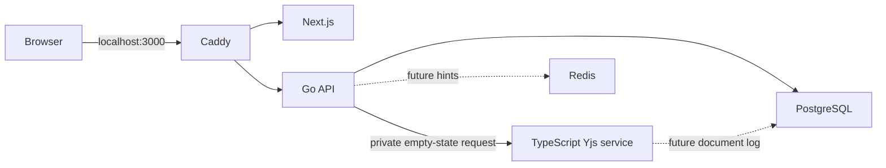

# Architecture (target and Phase 02 implementation)

The full design authority is `PROJECT_SPEC.md`. Browser traffic uses one origin: Caddy sends `/api/v1/*` and `/ws/*` to Go, and other routes to Next.js. Go owns public auth, metadata, authorization and WebSocket admission. A private TypeScript service will own Yjs decoding, validation, room state and document persistence. PostgreSQL is durable authority; Redis holds expendable hints. MinIO and a separate restricted runner enter in Phases 06 and 07. No hosted collaboration backend is part of this architecture.

Phase 02 adds versioned file/folder CRUD and a Next.js Monaco workspace to the Phase 01 identity and project API. Go locks the project row for each tree mutation, checks session/role/version, validates the resulting bounded tree, and writes metadata/events/outbox atomically in PostgreSQL. On file creation Go asks the private TypeScript service to construct an empty Yjs document state, then stores that state as a generation-one snapshot in the same transaction as the file/document metadata. The TypeScript service exposes this authenticated internal initializer and process liveness; it does not yet run rooms or accept edits. Redis remains configured but is not used for authorization. Health responses remain process liveness. Least privilege document-worker roles and durable update appends are later phase work.

Source boundaries: `apps/web` for browser UI, `services/api` for Go public API/gateway, `services/collab` for private Yjs authority, `packages/protocol` for shared TypeScript framing and fixtures, `contracts` for public and internal contracts, `db/migrations` for canonical SQL, `infra/compose` for local reproducibility. Go frame decoding stays envelope only; it never interprets Yjs payloads.

## Development topology

Dashed links describe planned integration. Local Docker credentials are development only and must be replaced before any deployment. `api` and `collab` are not published to the host by the base Compose file; Caddy is the sole host port. The test-only Compose override publishes PostgreSQL on localhost for integration tests. The TypeScript initializer is private and protected by a shared internal token; it has no general document write route.
