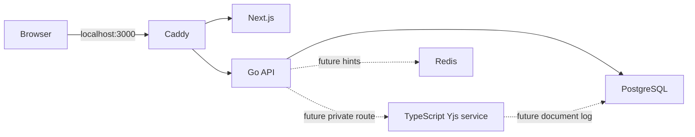

# Architecture (target and Phase 01 implementation)

The full design authority is `PROJECT_SPEC.md`. Browser traffic uses one origin: Caddy sends `/api/v1/*` and `/ws/*` to Go, and other routes to Next.js. Go owns public auth, metadata, authorization and WebSocket admission. A private TypeScript service will own Yjs decoding, validation, room state and document persistence. PostgreSQL is durable authority; Redis holds expendable hints. MinIO and a separate restricted runner enter in Phases 06 and 07. No hosted collaboration backend is part of this architecture.

Phase 01 runs Next.js project views and a Go API backed by PostgreSQL for OAuth flows, sessions, projects, memberships, invitations and metadata events. The private TypeScript collaboration service still exposes process liveness only. Redis is configured but not used for Phase 01 authorization. Health responses remain process liveness; Go startup separately requires database connectivity. Least privilege document-worker roles and Yjs persistence are later phase work.

Source boundaries: `apps/web` for browser UI, `services/api` for Go public API/gateway, `services/collab` for private Yjs authority, `packages/protocol` for shared TypeScript framing and fixtures, `contracts` for public and internal contracts, `db/migrations` for canonical SQL, `infra/compose` for local reproducibility. Go frame decoding stays envelope only; it never interprets Yjs payloads.

## Development topology

Dashed links describe planned integration. Local Docker credentials are development only and must be replaced before any deployment. `api` and `collab` are not published to the host by the base Compose file; Caddy is the sole host port. The test-only Compose override publishes PostgreSQL on localhost for integration tests. The TypeScript service exposes only an internal liveness route today.
