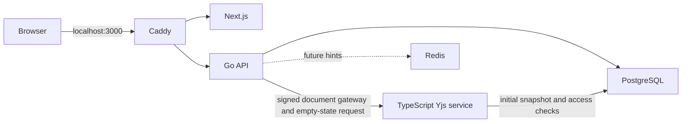

# Architecture (target and Phase 03 implementation)

The full design authority is `PROJECT_SPEC.md`. Browser traffic uses one origin: Caddy sends `/api/v1/*` and `/ws/*` to Go, and other routes to Next.js. Go owns public auth, metadata, authorization and WebSocket admission. A private TypeScript service owns Yjs decoding, candidate validation and volatile room state. PostgreSQL is durable metadata authority; edit appends start in Phase 04. Redis holds expendable hints. MinIO and a separate restricted runner enter in Phases 06 and 07. No hosted collaboration backend is part of this architecture.

Phase 02 added versioned file/folder CRUD and a Next.js Monaco workspace. Go locks the project row for each tree mutation, checks session/role/version, validates the resulting bounded tree, and writes metadata/events/outbox atomically in PostgreSQL. On file creation Go asks the private TypeScript service to construct an empty Yjs document state, then stores that state as a generation-one snapshot in the same transaction as file/document metadata. Phase 03 adds the Go document WebSocket gateway and a replayable project-event stream. Go validates Origin, session, active generation and membership before document upgrade, signs a 30-second scoped one-use assertion, and rechecks write access per update. The project stream reads ordered PostgreSQL events and rechecks membership; browsers refresh the tree/role on events. The private TypeScript worker verifies the document assertion and database scope, serializes room updates, validates candidate Yjs states in bounded worker threads, and broadcasts volatile updates. Monaco binds to Y.Text through y-monaco. Redis remains configured but is not used for authorization. Health responses remain process liveness. Least privilege document-worker roles and durable update appends are Phase 04 work.

Source boundaries: `apps/web` for browser UI, `services/api` for Go public API/gateway, `services/collab` for private Yjs authority, `packages/protocol` for shared TypeScript framing and fixtures, `contracts` for public and internal contracts, `db/migrations` for canonical SQL, `infra/compose` for local reproducibility. Go frame decoding stays envelope only; it never interprets Yjs payloads.

## Development topology

Dashed links describe planned integration. Local Docker credentials are development only and must be replaced before any deployment. `api` and `collab` are not published to the host by the base Compose file; Caddy is the sole host port. The test-only Compose override publishes PostgreSQL on localhost for integration tests. The initializer is protected by a shared internal token; document rooms use signed one-use scoped assertions. The Phase 03 worker has no durable document write route.
