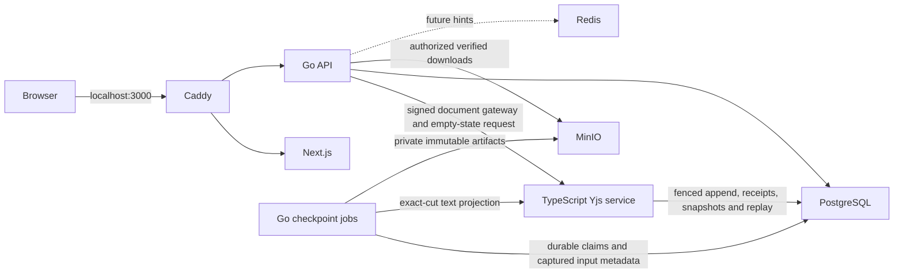

# Architecture (target and Phase 08 implementation)

The full design authority is `PROJECT_SPEC.md`. Browser traffic uses one origin: Caddy sends `/api/v1/*` and `/ws/*` to Go, and other routes to Next.js. Go owns public auth, metadata, authorization and WebSocket admission. A private TypeScript service owns Yjs decoding, candidate validation and fenced document rooms. PostgreSQL is authoritative for metadata and durable identified Yjs update logs/snapshots. Redis holds expendable hints. Phase 06 adds private MinIO artifacts and a separate Go checkpoint materializer sharing the API codebase. Phase 07 adds an opt-in separate execution agent and an authenticated private Go control listener, with no Docker control or runner token in browser/collaboration processes. No hosted collaboration backend is part of this architecture.

Phase 02 added versioned file/folder CRUD and a Next.js Monaco workspace. Go locks the project row for each tree mutation, checks session/role/version, validates the resulting bounded tree, and writes metadata/events/outbox atomically in PostgreSQL. On file creation Go asks the private TypeScript service to construct an empty Yjs document state, then stores that state as a generation-one snapshot in the same transaction as file/document metadata. Phase 03 adds the Go document WebSocket gateway and a replayable project-event stream. Go validates Origin, session, active generation and membership before document upgrade, signs a 30-second scoped one-use assertion, and rechecks write access per update. The project stream reads ordered PostgreSQL events and rechecks membership; browsers refresh the tree/role on events. The private TypeScript worker verifies the document assertion and database scope, serializes room updates, validates candidate Yjs states in bounded worker threads, and broadcasts only committed updates. Monaco binds to Y.Text through y-monaco. Redis remains configured but is not used for authorization. Health responses remain process liveness. Phase 04 uses scoped SQL functions through a limited worker login. The append transaction rechecks current authorization, expected head and DB-clock ownership fence before storing identified bytes and incrementing the contiguous sequence. Room state remains encoded outside bounded Yjs worker threads; hydration restores verified snapshots and retained tails. Automatic snapshots and an account-independent server receipt log preserve committed edits across worker death. Phase 05 adds account/generation-scoped IndexedDB state and identified outboxes, automatic authenticated reconnect, relative awareness and selective undo. The provider persists before send and reconciles exact receipts; rejected generations remain separately exportable. Presence is room-local and server identity derived. See contracts/provider.md for bounds, account privacy and disposal.

Source boundaries: `apps/web` for browser UI, `services/api` for Go public API/gateway and shared checkpoint worker code, `services/jobs` for worker operational notes, `services/collab` for private Yjs authority, `packages/protocol` for shared TypeScript framing and fixtures, `contracts` for public and internal contracts, `db/migrations` for canonical SQL, `infra/compose` for local reproducibility. Go frame decoding stays envelope only; it never interprets Yjs payloads. Checkpoint capture pins tree/heads/snapshot input references in one repeatable-read transaction. The private TS authority reconstructs those retained cuts; the Go jobs process uploads/readback-verifies canonical artifacts and publishes fenced readiness. Restore stages fresh TS documents, then preserves the latest previous cut and switches tree/pointers atomically under the append project's lock. See contracts/checkpoints.md.

## Development topology

Dashed links describe planned integration. Local Docker credentials are development only and must be replaced before any deployment. `api`, `collab`, `jobs` and MinIO are not published to the host by the base Compose file; Caddy is the sole host port. The test-only Compose override publishes PostgreSQL and MinIO's API on localhost for integration tests. Initializer/materialize/prepare endpoints are protected by a shared internal token; document rooms use signed one-use scoped assertions. The TS worker has no direct table writes, artifact credentials or session-token access, only SELECT on captured references plus its scoped append capabilities. See contracts/persistence.md and contracts/checkpoints.md for privileges, cuts and ambiguity handling.

Phase 07 captures each Run input through the same immutable checkpoint boundary after the browser drains edit receipts. PostgreSQL owns jobs, global per-user/per-project active quotas, claim tokens/leases, output receipts and monotonic status/output events. Private control verifies manifest/files before admission; the agent independently validates the delivered hash/file set. Only the agent mounts the Docker socket. User containers use pinned template IDs and per-attempt read-only source subpaths, no credentials/network, bounded cgroups/output/stdin/scratch, default seccomp and a PID 1 wall supervisor. The jobs process advances checkpoint-backed run states; expired execution fails without automatic retry. Public SSE revalidates current membership/session and resumes decimal event IDs. See contracts/execution.md and services/runner/README.md. Phase 08 adds versioned PostgreSQL search; observability and measured release remain Phase 09.

Phase 08 enqueues coalesced search revisions from committed heads and generation pointers. The shared Go jobs process claims captured document/snapshot cuts, asks the private TS authority for verified text, then publishes only a live claim for the current generation without regressing its sequence. Current filenames/paths and generation visibility come from SQL metadata, with project/session/membership locks through snippet serialization. The workspace shows eventual freshness and indexed versions; search never initializes editor content or execution inputs. See contracts/search.md and docs/phase08-review.md.
