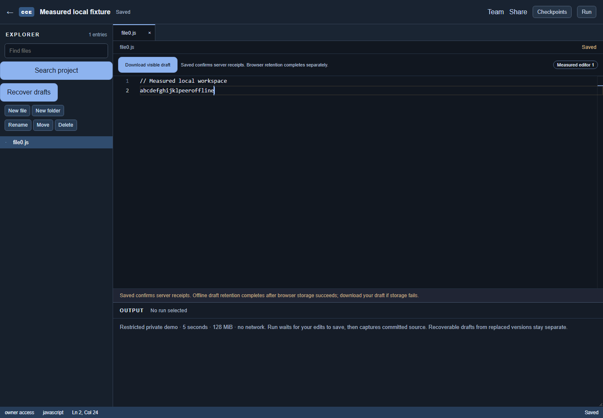
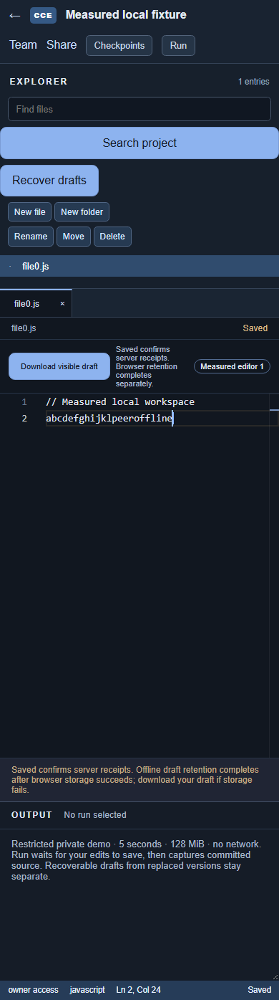
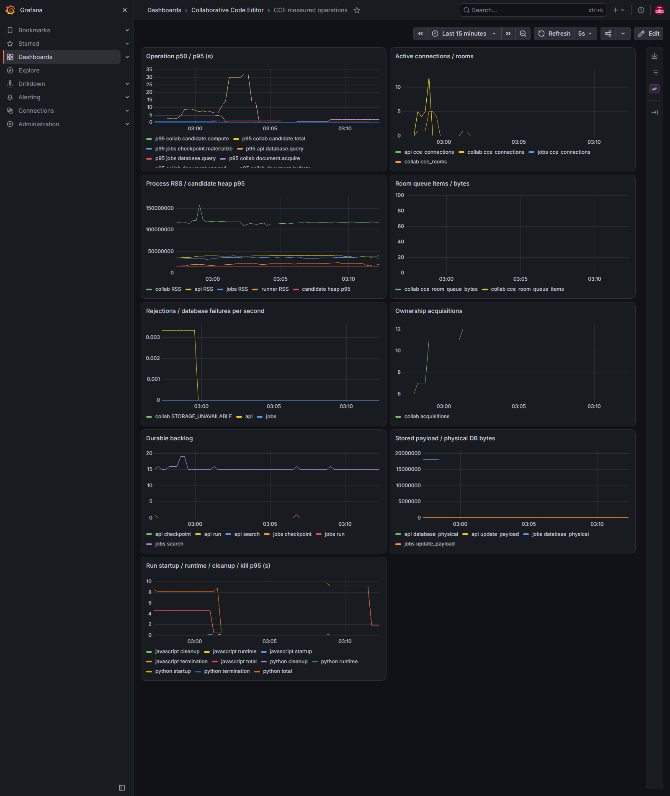

# Phase 09 measured local release review

The Phase 09 implementation has bounded local acceptance evidence. This is a
single-worker private demonstration, with a **portfolio release blocker: live
GitHub OAuth is unverified because credentials were not supplied**. No production,
WAN, sustained capacity, public hostile execution or disaster-recovery readiness
is claimed. See [implementation status](implementation-status.md) for all earlier
gaps, intermediate failures and final checks, and [claims ledger](claims-ledger.md).

Recorded 2026-10-05T21:28:02.439Z UTC (6 October 2026 Asia/Calcutta). Client Node v22.15.0,
npm 10.9.2, Yjs 13.6.27; container TS Node 24.21.0,
Go builds 1.27.1, PostgreSQL 18.6, browser Edge 154.0.4258.53,
Docker Engine 29.7.2. Host: 13th Gen Intel(R) Core(TM) i5-13450HX, 16 logical CPUs,
15.78 GiB RAM, Windows 10.0.26300.
Docker Desktop provides 16 CPUs and 7.64 GiB RAM.
Topology: Windows raw clients -> localhost Caddy -> Go -> one TS worker -> PostgreSQL in Docker Desktop; loopback, not WAN. One gateway, one TS worker, PostgreSQL, Redis,
MinIO/jobs and the private runner; local collector/Prometheus/Grafana also running.
These workloads ran after interruption suites finished, without overlapping
browser, backup or Go queue suites. Workload seeds determine operation choices,
not OS scheduling, Yjs client identities or a predetermined final text hash.

Raw fixtures initialize valid Yjs snapshots and committed file/generation pointers.
Each editor sends one identified update/second for an eight-second typing interval.
Positions alternate same-position and seeded random inserts/deletes. Five editors
then exercise offline concurrent edits, a 1.25-second paused TCP reader, a
120-frame burst, reconnect/retry and duplicate receipt lookup. All rejected inputs
remain identified pending work until they receive matching durable receipts.
The expanded scenario increases connections and documents without those faults.

| Scenario | Seed / initial bytes per file | Total measured duration | Generated / acknowledged / unresolved | Rejections | ACK p50 / p95 ms | Peer propagation p50 / p95 ms | Sync p50 / p95 ms |
|---|---|---|---|---|---|---|---|
| 5 editors / 1 documents | 90901 / 1024 | 39.8 s | 165 / 165 / 0 | {"RATE_LIMITED":1} | 13871.3 / 22073.0 | 110.3 / 3713.1 | 90.3 / 192.1 |
| 12 editors / 4 documents | 90902 / 8192 | 15.3 s | 96 / 96 / 0 | {} | 203.0 / 303.5 | 202.6 / 302.6 | 93.0 / 169.1 |

ACK is first transmission through receipt, including retry/wait time. The first
scenario's deliberately overloaded burst and twelve-second retry wait dominate
its ACK percentiles: **do not advertise these samples as subsecond save latency**.
Peer timing runs from a sent frame to another connected raw client's committed
update handler; it excludes physical rendering and disconnected recipients.
Sync measures socket establishment through committed state exchange. Exact sample
counts/maxima appear in [raw load JSON](measurements/phase09-load.json).

Every acknowledged input has one matching client/message/hash/sequence receipt,
one contiguous hashed DB row, and all replicas equal independent snapshot-plus-tail
replay. Duplicate delivery produces another original receipt and no extra row.
Both scenarios pass these checks; no unresolved edits or hidden rejected inputs.

| Scenario | Update payload growth bytes | Client RSS p95 MiB | TS RSS p95 MiB | API RSS p95 MiB | Sampled live rooms / peers max | Sampled queue items / bytes max |
|---|---|---|---|---|---|---|
| 5 / 1 | 3198 | 55.4 | 117.5 | 36.5 | 1 / 5 | 15 / 1230 |
| 12 / 4 | 2502 | 54.5 | 155.2 | 37.3 | 5 / 12 | 0 / 0 |

The expanded scenario's room gauge includes the previous idle room until eviction;
it has four new documents, not five new active documents. Scrapes occur every five
seconds, so sampled maxima can miss brief spikes; zero sampled queue is not zero
work. JSON also records encoded state, physical DB/update payload, durable job
backlog and cumulative ownership samples. Existing intentionally failed fixtures
contribute backlog; it is not a new workload failure or a claim that all historical
jobs are ready. Storage growth is update payload, not total disk/object growth.

| Scenario / candidate measurement | Observations | Mean | p50 bucket upper bound | p95 bucket upper bound |
|---|---|---|---|---|
| 5 / 1: candidate.heap | 191 | 10.4 MiB | 15.3 MiB | 15.3 MiB |
| 5 / 1: candidate.compute | 191 | 7.7 ms | 10.0 ms | 25.0 ms |
| 5 / 1: candidate.total | 191 | 74.8 ms | 100.0 ms | 100.0 ms |
| 12 / 4: candidate.heap | 124 | 10.3 MiB | 15.3 MiB | 15.3 MiB |
| 12 / 4: candidate.compute | 124 | 7.3 ms | 10.0 ms | 25.0 ms |
| 12 / 4: candidate.total | 124 | 76.4 ms | 100.0 ms | 100.0 ms |

These are **differences of scraped cumulative histograms**, with bucket upper
bounds, not exact percentile samples. Candidate total includes worker startup and
termination; compute excludes them. Heap is a successful isolated worker sample,
not peak allocation/RSS. Shared background reconstruction can contribute samples.
Hydration and other operation deltas are in the same JSON. Ownership acquisition
counts reset on restart and describe fenced acquisitions, not unique documents.

Separate browser check: two independent authenticated contexts, 1440×1000 then
390×844, twelve sequential characters with receipt waiting plus offline concurrent
edits. [Browser JSON](measurements/phase09-browser.json) records definitions/counts.

| Browser measurement | p50 / p95 ms |
|---|---|
| connect_sync_ms | 218.5 / 300.3 |
| local_render_ms | 16.7 / 30.0 |
| local_retention_ms | 9.7 / 48.1 |
| durable_ack_ms | 117.0 / 183.6 |
| Peer Monaco DOM observation (12 edits, includes polling) | 210.6 / 538.1 |

Reconnect including retained outbox drain: 1219.0 ms,
one observation. Rendering is keydown through two requestAnimationFrame callbacks,
a paint-opportunity proxy, not physical display time. Background Monaco painting
is inspected after each tab is foregrounded. Exact visible text, retained state
and server replay agree; no page errors/whole-page horizontal overflow.

Separate [run/hydration stage report](measurements/phase09-stages.json) contains
the exact PromQL queries and p50/p95 histogram estimates: runner stages use the
current process's cumulative buckets since restart, including two actual
cancelled runs; hydration uses a separate thirty-minute rate window. Runner startup measures
admission to Docker attach command start; runtime includes attached transport;
termination measures Docker kill completion; cleanup is separate. Startup is not
time to first user instruction. These stages are never substituted for edit ACKs.

[Sequential failure evidence](measurements/phase09-failures.json) records 21
passed tests, zero skips: real process death/storage/Redis failure, owner recovery,
drafts/undo/cursors/viewer denial/checkpoint restoration/immutable runs and resource
enforcement. [Jobs death](measurements/phase09-jobs-death.json) adds actual
checkpoint/search SIGKILL with accelerated expiry. [Backup](measurements/phase09-backup.json)
adds local isolated exact replay/artifact/fresh-generation recovery. See their
scope qualifications; no natural lease-delay/disaster RPO/RTO claim.

[Live sentinel report](measurements/phase09-observability.json) proves authorized
stdin/stdout reaches the bounded job output while sentinel source/auth/input/output
is absent from inspected global logs/traces and metric labels. Four targets scrape;
Go/TS correlation and DB/jobs spans export. [Dashboard acceptance](measurements/phase09-dashboard.json)
checks authenticated provisioning and successful query requests. Prometheus config
and four alert rules validate; notification delivery and long-term tracing do not.

Reproduce using [setup](setup.md), [observability definitions](observability.md),
the opted-in npm scripts and [four-minute demo](demonstration.md). Run faults,
queue checks and load separately. This is short bounded evidence, not sustained
capacity, fairness, WAN latency, ceiling saturation, live OAuth or public release.
Phase 10 remains optional and unavailable until the portfolio gate is verified.
